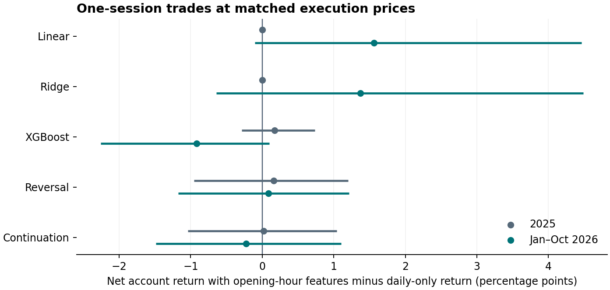

# Execution costs in the inverse-return forecasting study

This review covers the earlier forecast that traded deviations from a fitted inverse-return relationship. The subsequent gap-reopening study asks whether shorting the rising laggard adds value once the leader-only trade is sized to comparable factor exposure. [Matched short-leg attribution](../outputs/runs/inverse_short_leg_review/report.md)

**Decision.** Keep the validation gate and its cash outcome. The strongest retrospective trade rule earned 1.89% on a $100,000 account. Its profitability depended on a small number of oil ETF trades and on the ability to short both legs. Neither walk-forward deployment had a forecast that qualified for trading. [Deployment decisions for 2025](../outputs/runs/strict_inverse_alpha_final/2025/validated_alpha.csv) · [Deployment decisions for 2026](../outputs/runs/strict_inverse_alpha_final/2026/validated_alpha.csv)

## What an order represents

The screen requires return correlation of −0.80 or lower. The signal measures how far A moved from its fitted response to B. With a negative fitted slope, a long residual buys both legs and a short residual sells both. Borrow availability can therefore veto the entire short trade. Gross exposure, time held and financing matter even for a statistically strong inverse pair.

Both forecast variants see the same ETF pairs and route orders on the same clock. The daily model sees information through the previous close. The enhanced model also sees the opening hour. The final feature bar ends at 10:30 New York time. The first eligible execution price is the **close of the bar starting at 10:31**. Both legs need positive-volume, synchronized prints. Entry and exit participation on each leg is capped at 1% of the smaller of trailing average daily dollar volume and realized fill-minute dollar volume. A liquidation can span multiple bars. The simulation assumes fractional units, 2 bp per filled dollar, 2% annual financing on gross inventory and an additional 0.5% on short inventory. [Execution implementation](../inverse_tracking_study.py) · [Research configuration](../outputs/runs/strict_inverse_alpha_final/manifest.json)

## Where the strongest holdout result came from

The one-session linear rule with opening-hour features was the highest-returning configuration in the Jan 2–Oct 23, 2026 holdout. It is a retrospective case study of execution dependence. It had failed the validation gate before that period.

| Account and fills | Observed in the modeled book |
|---|---:|
| Gross trading PnL | $2,152.04 |
| Execution / financing / borrow | $226.57 / $34.59 / $4.72 |
| Net trading PnL | $1,886.16 |
| Absolute filled notional, counting both legs and both sides of each round trip | $1,132,853 |
| Median entry gross / maximum entry gross allowed | $15,466 / $25,000 |
| Average holding time / session-weighted gross exposure | 26.68 hours / 2.73% |
| Longest delay to complete a scheduled exit | 7 minutes |
| Return / maximum drawdown | 1.89% / 1.69% |
| 95% ten-session block-bootstrap interval for account return | −2.08% to +6.93% |

SCO/USO generated $1,704.85 from 30 of 36 trades. The two largest individual gains totaled $2,849.17. Removing just those gains leaves **−$963.01**. This deletion measures realized concentration with the remaining fills held fixed. In a separate replay that rejected short entries, the rule made 22 trades and lost **0.87%**. [Per-pair attribution](execution_exhibits/pair_attribution.csv) · [Trades](../outputs/runs/strict_inverse_alpha_final/2026/test/trades.parquet) · [Per-leg executions](../outputs/runs/strict_inverse_alpha_final/2026/test/executions.parquet) · [No-locate replay](../outputs/runs/strict_inverse_alpha_final/2026/test/no_locates.csv)

## What execution costs could the realized fills absorb?

The realized book had $2,112.73 left after financing and borrow, before execution charges. Dividing by $1.133 million in absolute filled notional gives a **break-even total charge of 18.65 bp per filled dollar**, including the original 2 bp. Each additional basis point costs about $113.29 on this ledger.

| Total execution charge per filled dollar | Net PnL on identical fills |
|---:|---:|
| 2 bp, study assumption | +$1,886.16 |
| 5 bp | +$1,546.31 |
| 10 bp | +$979.88 |
| 20 bp | −$152.97 |

These are arithmetic sensitivities. Changing the cost used at order submission would also change which forecasts clear the entry hurdle. Realized minute volume constrains simulated fills after submission. Historical quotes, order-book depth, arrival midpoints, queue position, contemporaneous locates and security-specific borrow fees were unavailable. The ledger can reconcile dollars and units, but it cannot measure implementation shortfall against an arrival price or establish the account size at which market impact absorbs the signal. [Cost sensitivity](execution_exhibits/cost_sensitivity.csv) · [Reconciliation code](../backtest/execution_review.py)

## Did faster data or sequential control earn their complexity?

For the one-session linear rule in 2026, adding opening-hour information improved realized net return by **1.56 percentage points** against its matched daily-only version. The paired 95% block interval was **−0.10 to +4.46 points**. XGBoost moved in the opposite direction at the same horizon. Across models, resolutions and horizons, the corrected comparisons did not establish a repeatable gain from opening-hour features. The intervals in the figure are individual paired intervals. The linked table also reports the multiplicity-adjusted tests. [Paired granularity results](../outputs/runs/strict_inverse_alpha_final/evidence/paired_granularity.csv)

In the earlier daily head-to-head, fixed Ridge stayed flat. PPO with the same forecast incurred $41.27 in costs and lost 1.37 bp on the account. Plain PPO matched cash. The new minute study produced no qualifying forecast for a historical PPO controller. The remaining execution question is whether a **preselected** residual forecast covers observed side-specific spread, impact and borrow. A quote-and-locate replay with decision timestamps and actual fill benchmarks would answer that question more directly than a larger PPO training budget. [Historical PPO comparison](../outputs/runs/strict_inverse_alpha_final/evidence/historical_ppo_paired.csv) · [Full methodology and limitations](../outputs/runs/strict_inverse_alpha_final/report.md)
